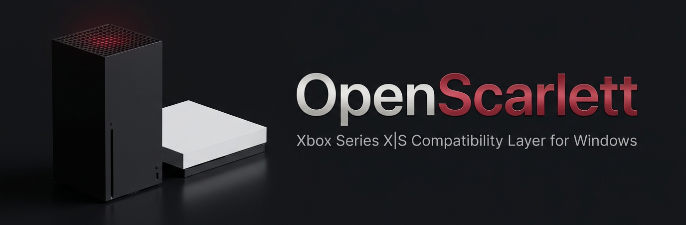
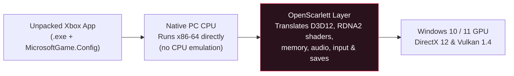
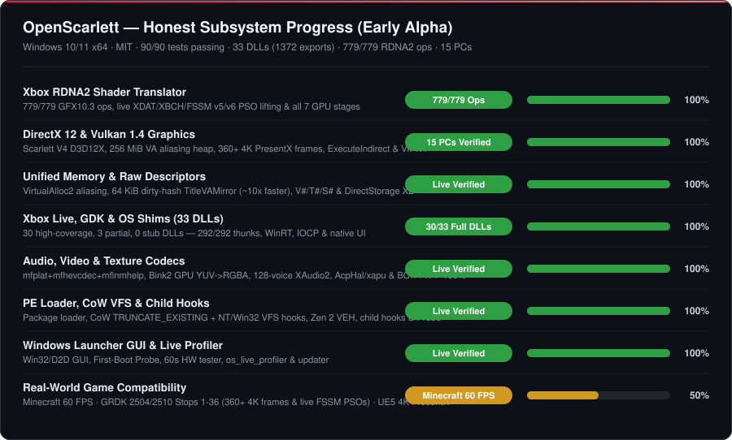

<p align="center">
  
</p>

<p align="center">
  <a href="https://github.com/californiaAlmonds/OpenScarlett/releases/latest"></a>
  <a href="https://github.com/californiaAlmonds/OpenScarlett/actions/workflows/ci.yml"></a>
  <a href="https://californiaalmonds.github.io/OpenScarlett/"></a>
  <a href="LICENSE"></a>
</p>

<p align="center">
  Because Xbox Series X|S uses an <strong>AMD x86-64 processor</strong> like a gaming PC, <strong>OpenScarlett</strong> runs game CPU code natively on Windows 10 &amp; 11 instead of slow emulation — translating only the Xbox-specific graphics, RDNA2 shaders, audio, input, and OS calls to native <strong>DirectX 12</strong> &amp; <strong>Vulkan 1.4</strong>.
</p>

> **Disclaimer:** OpenScarlett is strictly for legally obtained, unencrypted apps and SDK samples. We do not support, include, or encourage DRM bypass or retail package decryption.

---

## Where Do We Stand Right Now?

OpenScarlett is in **early alpha** (`v0.3.1-alpha`, **`41/41` automated tests passing**). Simple Xbox-ABI games, official Microsoft Xbox GDK 3D/Mesh/HDR/Ray-Tracing samples, and a shadowed 3D dual-API (DirectX 12 + Vulkan 1.4) workload run live on real NVIDIA and AMD PCs today. Larger commercial Xbox Series games are **not playable yet** — we are building toward them step by step.


| Working Today | Building Next |
| :--- | :--- |
| Plays **Freedoom** & **ScarlettArena** at 60 FPS with live controller, audio & saves | All-in-one Windows Launcher GUI with built-in 60s Hardware Tester & SHA-256 updater |
| Runs official Microsoft Xbox GDK 3D, Mesh Shader, HDR10 & Ray-Tracing samples | Larger open-source 3D & commercial GDK title bring-up |
| Direct Xbox DirectX 12 → **Vulkan 1.4** command-list routing + shadowed 3D scene | Broader RDNA2 shader corpus validation across more engines |
| Matches **292/292** shipping GDK runtime functions across **30** shimmed DLLs on **6 real PCs** | Hardware testing on Intel Arc, RTX 40/50, RX 6000 & handheld APUs |

---

## How It Works



---

## Core Subsystems



---

## Help Test on Your GPU (60 Seconds, No Coding Needed)

Every new GPU and Windows build helps us catch real driver, wave-size, and memory-aliasing quirks we cannot reproduce locally.

1. **[Download the latest `OpenScarlett-*-win64.zip`](https://github.com/californiaAlmonds/OpenScarlett/releases/latest)** and extract anywhere *(everything — including open-source `dxc.exe` — is bundled; no Visual Studio or SDK required)*.
2. **Double-click `run_hardware_test.bat`** — probes your GPU, runs all tests, and automatically strips usernames & local folder paths.
3. **Press `Enter`** when prompted to open a pre-filled GitHub Hardware Report and click **Create**.

| Hardware Tier | Tested Status |
| :--- | :--- |
| **NVIDIA Turing & Ampere** *(GTX 16 / RTX 20 / RTX 30)* | 🟢 Verified (`GTX 1650 Ti`, `RTX 2060 SUPER`, `RTX 3080 Ti`) |
| **AMD RDNA 3 & RDNA 4** *(RX 7000 / RX 9000)* | 🟢 Verified (`RX 7600`, `RX 7900 XTX`, `RX 9070 XT`) |
| **NVIDIA Ada & Blackwell** *(RTX 40 / RTX 50)* | 🟡 Tester Needed |
| **AMD RDNA 2 & Handheld APUs** *(RX 6000 / ROG Ally / Legion Go)* | 🟡 Tester Needed |
| **Intel Arc & Integrated GPUs** *(A-Series / B-Series / Xe)* | 🟡 Tester Needed |

---

## Technical Details

<details>
<summary><strong>Subsystem &amp; 30-DLL Breakdown (Auto-Generated)</strong></summary>
<br/>

<!-- OPENSCARLETT_STATUS_START -->
**Automated Tests:** `41/41` passing · **Shimmed DLLs:** `30` · **Shipping GDK Thunks:** `292/292` · **Verified Hardware:** `6 PCs` (`NVIDIA` + `AMD`)

| Subsystem | Area | Status | Progress | Technical Coverage | Verified On |
| :--- | :--- | :--- | :---: | :--- | :--- |
| **PE32+ Loader, CoW VFS, 30-DLL Routing & Child-Hook Propagation** | `Loader` | 🟢 Live-Binary Verified | `100%` | `MicrosoftGame.Config` XML loader, nested `G:` CoW overlay VFS (zero base/`C:` writes), `System32`-first `KnownDLL` resolution, RVA-0 reloc & `.xdata` v2/v3 unwind validation, Kahn topo init, 30-DLL routing, `CreateProcessW/A` child-process APC hook propagation | Win10 & Win11 26H2 (`test_s7_pe_gdk_runtime`, `test_loader_child_hook_parity`, `test_loader_vfs_config`, `Pizza House Simulator` + `House Flipper 2`) |
| **`d3d12_xs` Proxy, Direct Vulkan 1.4 Routing, HDR10 `PresentX` & `xg_xs`** | `Graphics` | 🟢 Live-GPU Verified | `100%` | Direct `d3d12_xs`→Vulkan 1.4 command-list routing (`--backend=vulkan`), Wave32-on-Wave64 compute, staged BC copies, `OPENSCARLETT_VK_DEVICE` selection, mixed-heap slot separation, `R9G9B9E5`→`RGBA16F` UAV fallback, `KickoffX`/`Wait32/64BitValueX`/`RSSetDepthBiasX`, HDR10/scRGB `PresentX`, full GFX10 `xg_xs` + `HTILE`/`DCC`/`CMASK` & `XGEncodeDCC` fuzz check | 6 GPUs (GTX 1650 Ti, RTX 2060 SUPER/3080 Ti, AMD RX 7600/7900 XTX/9070 XT) + WARP (`test_d3d12_vk_routing`, `test_gpu_d3d12x_vk_parity`, `test_vulkan_graphics_live`, `test_vulkan_mesh_showcase`, `test_hdr10_d3d12`) |
| **RDNA2/GFX10.3 Shader Lifter, Lockstep LDS Barriers, `PSV0` & DXIL Re-Signing** | `Shaders` | 🟢 Live-GPU Verified | `100%` | RDNA2/GFX10.3 disasm/IR/lifter (single-wave lockstep LDS barriers, `s_icache_inv`/`s_ttracedata`/`s_code_end`/`s_version` no-ops, clamped shifts, `v_cmpx`, split `f16`, MTBUF `d16`, NaN/denorm, `PSV0` wave bounds, Wave32-on-64 isolation, mesh `merged_wave_info`/`CullPrimitiveEXT`, FSSM/vfetch, DXIL MD5 re-signing), CPU interpreter, content-hashed disk cache | `spirv-val` + `dxc` SM 6.5 + 6 GPUs + WARP (`test_rdna2_lockstep_isa`, `test_rdna2_corpus_parity`, `test_rdna2_lifter_live`, `test_d3d12_xs_autolift`) |
| **Xbox Unified Memory (`kernelx` / `xmem`), `GpuTilePool` & `dstorage_xs`** | `Memory & IO` | 🟢 Live-Binary Verified | `100%` | Win10/11 `VirtualAlloc2`/`MapViewOfFile3` 64 KiB & 4 MiB aliasing, `GpuTilePool`, `XMemVirtualQuery` + ERA allocation attributes, placed GPU VA attach, `dstorage_xs` cancellation + bounds + direct physical-page decompression | Win10 & Win11 26H2 (`test_kernelx`, `test_s7_pe_gdk_runtime`, `test_dstorage_audio_diag_parity`, `test_xg_dstorage`) |
| **BCPack BC1–BC7, RDNA2 BVH4, Opus/XMA2/WASAPI, `X3DAudio` & GPU FSR 1.0** | `Media` | 🟢 Live-GPU Verified | `100%` | GDeflate v1, BCPack BC1–BC7 (ring-window/selector-table/NPOT/multi-mip), RDNA2 BVH4 decoder + SAH BVH2→BVH4, XMA2 IMDCT, `MSOpusDecoder` Opus (`0x704F`), IMA-ADPCM, WASAPI (all MMDevice formats), `X3DAudio`/`XAudio2FX`, Bink2, live GPU FSR 1.0 | 6 PCs (GTX 1650 Ti, RTX 2060 SUPER/3080 Ti, AMD RX 7600/7900 XTX/9070 XT) + WARP (`test_codecs`, `test_bcpack_bvh4`, `test_audio_opus_wasapi`, `test_d3d12_xs_live`) |
| **GDK & Console Shims (30 DLLs, 292/292 Thunks, WinRT 20 Exports & Raw Input)** | `GDK Shims` | 🟢 Live-Binary Verified | `100%` | 30 shimmed DLLs: `xgameruntime` (**292/292** shipping `XGamingRuntimeThunks.dll` parity, 24 COM `QueryApiImpl` interfaces, `XGameStreaming`/`XSystem`/headless `XStore`), `XCurl` (16/16), `XSAPI` (178), `GameInput` (XInput + Raw Input mouse), `winrt_xs` (20 exports), `mfplat_xs`, `advapi32legacy`, `KernelTraceControl`, `hix_xs`, `xbtp`, `mflnmhelp`, `mfhevcdec`, `gamecoreclient`, `minuserx`, `xtfpix`, `xtfdebugmonitor` | Live commercial `Alexandria IV DEMO` shipping thunks (`0 E_NOINTERFACE`), Win10 & Win11 26H2 (`test_real_gdk_thunks_live`, `test_s7_pe_gdk_runtime`, `test_xgr_conformance_parity`, `test_winrt_xs`) |
| **Playable Demos, Dual-API 3D GDK Scene & Hardware DXR Tier 1.1** | `Workloads` | 🟢 Live-GPU Verified | `100%` | Live 60 FPS **Freedoom: Phase 1** & `ScarlettArena`, 3D shadowed/skinned BC1+BC3 GDK scene over BOTH D3D12 & Vulkan 1.4 (`test_gdk_3d_scene_dual_api`), `ID3D12Device5` DXR 1.1, `SimplePBR`, `MeshletCull`, `SimpleLighting`, `HDRCubeMap`, `VulkanMeshShowcase` (`not_impl=0`) | GTX 1650 Ti (HW + WARP, D3D12 + Vulkan 1.4), RTX 2060 SUPER/3080 Ti (`DXR=12`), AMD RX 7600/7900 XTX/9070 XT (`DXR=11`) (`test_scarlett_game_live`, `test_gdk_3d_scene_dual_api`, `test_dxr_live`, `test_vulkan_mesh_showcase`) |
| **Native Win32/Direct2D `OpenScarlettLauncher.exe` + Opt-In SHA-256 Updater** | `UX & Tools` | 🟡 In Progress | `40%` | Wave 2 in progress: native Win32/Direct2D GUI shell, integrated 60s Hardware Self-Test runner, PE32+ inspector, and opt-in WinHTTP + BCrypt SHA-256 verified updater (CLI & `run_hardware_test.bat` live today) | Wave 2 active (`run_hardware_test.ps1` / `.bat` verified on 6 PCs) |

_Auto-generated from live CTest results via `python tools/generate_status.py --build-dir build`._
<!-- OPENSCARLETT_STATUS_END -->

</details>

<details>
<summary><strong>Live-GPU &amp; Real-Binary Verification Matrix (Workloads, Frame Hashes &amp; Timings)</strong></summary>
<br/>

All live measurements below were recorded on **Windows 10 x64** with **NVIDIA GeForce GTX 1650 Ti** (`3935 MB` VRAM, `SM 6.5`, **Hardware Mesh Shaders `MeshTier=10`**, `Wave=32`, `DXR=0`, **Vulkan `1.4.329`**) and **D3D12 WARP** (`SM 6.2`), plus community hardware passes on RTX 2060 SUPER, RTX 3080 Ti, and AMD RX 7600 / RX 7900 XTX / RX 9070 XT. Standalone GDK samples execute inside isolated folders with **zero shim DLLs copied next to the `.exe`**, launched via `openscarlett.exe run`.

| Target / Workload | Type | Adapter | Result | Measured Output / FNV-1a Frame Hash | GPU Frame | Live `CallTelemetry` Blockers |
| :--- | :--- | :--- | :---: | :--- | :---: | :---: |
| **3D Shadowed Skinned BC1+BC3 GDK Scene (`gdk_3d_scene`)** | Real Dual-API GDK Binary (`openscarlett run <pkg>`) | **NVIDIA GTX 1650 Ti (D3D12 + Vulkan 1.4) & WARP** | 🟢 **Live Pass** | Textured 3D camera-driven skinned mesh, depth & shadow pass, BC1/BC3 textures, audio cue; routed directly over both D3D12 and `--backend=vulkan` | — | `0` (`test_gdk_3d_scene_dual_api`) |
| **Direct `d3d12_xs` → Vulkan 1.4 Routing & Edge Cases** | Live Dual-API Routing (`test_d3d12_vk_routing`) | **NVIDIA GTX 1650 Ti (`Vulkan 1.4.329`) & WARP** | 🟢 **Live Pass** | Direct `d3d12_xs` command-list draw/dispatch/mesh/copy/PresentX routed to Vulkan 1.4, Wave32-on-64 compute, staged BC copies, mixed-heap slot separation, `OPENSCARLETT_VK_DEVICE` override | — | `0` (`test_d3d12_vk_routing`) |
| **Playable Freedoom: Phase 1 (`ScarlettDoom` + `freedoom1.wad`) & `ScarlettArena`** | Real Playable Game (`openscarlett run <pkg>`) | **NVIDIA GTX 1650 Ti & D3D12 WARP** | 🟢 **Live Playable** | `640×400` 60 FPS `PresentX`: Freedoom E1M1 **131 frames / 129 unique hashes** (`255,916` non-black px), live `GameInput` + `XAudio2_9`, `S:\` `XGameSave`, read-only `G:\` untouched; `ScarlettArena` 45f / 41 hashes | `16.67 ms` (60 FPS) | `0` (`5,856` calls / `105` symbols across `d3d12_xs`, `kernelx`, `xgameruntime`, `GameInput`, `XAudio2_9`, `vfs`) |
| **Real Shipping Commercial GDK Thunks (`Alexandria IV DEMO`)** | Real Shipping Thunks (`test_real_gdk_thunks_live`) | **Windows 10 x64** | 🟢 **Live Pass** | **292/292** `xgameruntime.dll` parity, **16/16** `XCurl.dll`, **24 real 3-arg COM `QueryApiImpl` interfaces** (`110` calls, `TitleId=0x6BFFDF10`) | — | `0` (**zero `E_NOINTERFACE`**) |
| **Commercial Multi-Process Win32 Launchers (`Pizza House Simulator` & `House Flipper 2`)** | Real Multi-Process Launch (`openscarlett run`) | **Windows 10 x64** | 🟢 **Live Pass** | `CreateProcessW` child-process APC hook propagation (`PizzaHouseSimulator.exe` → `*-Win64-Shipping.exe`; `HouseFlipper2.exe` 3-generation children), per-PID telemetry, zero `C:\` writes | — | `0` (`child_hook_propagated`, `child_hook_attached`) |
| **Microsoft `Xbox-GDK-Samples` / `SimpleTriangle`** | Real GDK Binary (`openscarlett run`) | **GTX 1650 Ti (`SM 6.5`) & WARP** | 🟢 **Live Pass** | `256×256`, 8,192 RGB tri px, **bit-exact HW == WARP `0xB8E29520F579D065`** | `3.51 ms` (HW) / `3.08 ms` (WARP) | `0` (`68` calls / `47` symbols) |
| **Microsoft `Xbox-GDK-Samples` / `SimpleMeshShader`** | Real GDK Binary (`ms_6_5` + `ps_6_5`) | **GTX 1650 Ti (`MeshTier=10`)** | 🟢 **Live Pass** | `256×256`, 8,192 RGB tri px, `0x617ACFC269023CA5` | `2.83 ms` | `0` (`57` calls / `38` symbols; `DispatchMesh` #79) |
| **Microsoft `Xbox-GDK-Samples` / `SimpleCompute`** | Real GDK Binary (`fractal.hlsl` Mandelbrot) | **GTX 1650 Ti & WARP** | 🟢 **Live Pass** | `256×256`, 50,528 col / 15,008 set / 32 bands, `0x7062D0C262252A26` | `3.40 ms` (HW) / `5.73 ms` (WARP) | `0` (`66` calls / `41` symbols) |
| **Multi-Frame 3D `SimplePBR`** (`4× MSAA`, `D32_FLOAT`, PBR textures, `ResolveSubresource`) | Real GDK Binary (`openscarlett run <pkg>`) | **GTX 1650 Ti & WARP** | 🟢 **Live Pass** | `256×256`, 1,280 tris, 3 frames (`F2=0xDC2F8F3277DA04C8`), HW vs WARP `MAE = 0.0264 / 255` | `1.02 ms` (HW) / `9.80 ms` (WARP) | `0` (`188` calls / `68` symbols) |
| **`MeshletCull` (`as_6_5` + `ms_6_5` + `ps_6_5` Frustum + Cone Culling)** | Real GDK Binary (`openscarlett run <pkg>`) | **GTX 1650 Ti (`MeshTier=10`) & WARP** | 🟢 **Live Pass** | `256×256`, **6/16 surviving · 6 frustum · 4 cone culled**, HW vs WARP `MaxDiff = 1 LSB` | `4.62 ms` (HW) / `15.69 ms` (WARP) | `0` (`86`–`99` calls) |
| **`DXRTriangle` (`lib_6_3` HW RT / `XboxBvhBuilder` SAH BVH)** | Real GDK Binary (`openscarlett run <pkg>`) | **GTX 1650 Ti (`DXR=0` SW) & WARP** | 🟢 **Live Pass** | `256×256`, 10,112 hits, **bit-exact HW == WARP `0xE52BF8857986B576`** | `63.74 ms` (SW) | `0` (`65,613` calls / `49` symbols) |
| **`SimpleLighting` (3D Blinn-Phong + `D32F` + `XDisplay` + `X3DAudio`/`XAudio2FX`)** | Real GDK Binary + Live Vulkan 1.4 | **GTX 1650 Ti (D3D12 + Vulkan 1.4) & WARP** | 🟢 **Live Pass** | `256×256`, 812 tris, **Vulkan 1.4 vs D3D12 HW bit-exact `MAE = 0.0000`**; `X3DAudio` Doppler `1.066→0.942` | `4.14 ms` (D3D12) / `13.49 ms` (Vk) | `0` (`184` calls / `83` symbols) |
| **`HDRCubeMap` (`FP16 TextureCube` + Default Array SRV + HDR10 ST.2084)** | Real GDK Binary (`openscarlett run <pkg>`) | **GTX 1650 Ti (HDR10 & SDR) & WARP** | 🟢 **Live Pass** | `256×256`, **6/6 Cube == 6/6 Default Array SRV (`0.00 nits` diff)**, ST.2084 peak `666.7 nits`, ACES + Reinhard fallback | `210.0 ms` (HW) | `0` (`175` calls / `64` symbols) |
| **`VulkanMeshShowcase` (Raw RDNA2 `XS2\0` `AS`+`MS`+`PS` + `32³` 3D LUT)** | Real GDK Binary + `VK_EXT_mesh_shader` | **GTX 1650 Ti (Vulkan 1.4 + D3D12) & WARP** | 🟢 **Live Pass** | `256×256`, 19,800 px, **Vulkan 1.4 `VK_EXT_mesh_shader` vs D3D12 `MeshTier=10` `MAE = 0.0000`** | `7.04 ms` (Vk) / `3.37 ms` (D3D12) | `0` (`82`–`91` calls) |
| **Untouched MIT `Microsoft Xbox-GDK-Samples` / `SimpleDirectStorageCombo`** | Untouched External MIT Binary | **Windows 10 x64** | 🟢 **Live Pass** | `SimpleLoad`, `StatusBatch`, `CompletionEvent`, `MultipleQueues`, CoW pkg `0x6824D2954256492C` byte-identical | — | `0` (`769` calls / `17` symbols) |
| **RDNA2 Corpus Lifter, Lockstep LDS Barriers, Differential ISA & Disk Cache** | Live Dual-GPU (`spirv-val` + `dxc` SM 6.5) | **GTX 1650 Ti (Vulkan 1.4 & D3D12) + WARP** | 🟢 **Live Pass** | Lockstep 1-wave LDS barriers, `s_bfe`/`v_cvt_(pk)norm`/`image_load` diff tests, `PSV0`, DXIL MD5 re-signing, `XS2\0` auto-lift + `DiskHit=1` | — | `0` (`test_rdna2_lockstep_isa`, `test_rdna2_corpus_parity`, `test_rdna2_lifter_live`, `test_d3d12_xs_autolift`) |
| **Interactive `PresentX` Windowing, Opus/WASAPI, `xg_xs` & GPU FSR 1.0** | Live Swapchain / Audio / GPU | **6 GPUs (NVIDIA + AMD) & WARP** | 🟢 **Live Pass** | `60`/`120 Hz` pacing, waitable latency, `MSOpusDecoder` MFT + WASAPI, 15 2D + 6 3D `xg_xs` + `XGEncodeDCC` 1,000-case fuzz, AMD RDNA3/4 FSR 1.0 `0 LSB` vs WARP | `16.67 ms` (paced) | `0` (`test_presentx_windowing`, `test_audio_opus_wasapi`, `test_s7_pe_gdk_runtime`, `test_d3d12_xs_live`) |
| **Hardware DXR Tier 1.1 (`hardware-DXR` + SAH SW Fallback)** | Live HW RT Cores & SW BVH (`test_dxr_live`) | **RTX 2060S/3080 Ti (`DXR=12`), RX 7600/7900 XTX/9070 XT (`DXR=11`), GTX 1650 Ti & WARP** | 🟢 **Live Pass** | `160×120`, `92.82%` hit rate, exact `0x86443514BF44B806` across NVIDIA Turing/Ampere, AMD RDNA3/4 & WARP | — | `0` (`test_dxr_live`) |

</details>

<details>
<summary><strong>Build From Source, CLI Usage &amp; Sprint Changelog</strong></summary>
<br/>

### Requirements (Windows 10 / 11 x64)
- Windows 10 (1903+) or Windows 11 (x64)
- Visual Studio 2022 (MSVC C++20) + Windows 10/11 SDK (with `dxc.exe`)
- CMake 3.20+ and Ninja

### Build & Run Tests
```powershell
cmake -S . -B build -G Ninja -DCMAKE_BUILD_TYPE=Release
cmake --build build --parallel
ctest --test-dir build --output-on-failure
```

### CLI Usage
```powershell
# Inspect your PC's D3D12, DXR, Mesh Shader, Wave lane, Vulkan, and DXC support
.\build\openscarlett.exe probe-gpu

# Inspect any x64 .exe or .dll to see its Xbox / GDK / Windows imports & exports
.\build\openscarlett.exe inspect path\to\binary.exe

# Launch an unpacked Xbox GDK / Series X|S package folder
.\build\openscarlett.exe run path\to\package_dir_or_game.exe --telemetry report.json
.\build\openscarlett.exe run --backend=vulkan path\to\package_dir_or_game.exe
```

### Milestone Changelog
- [x] **Bootstrap (`v0.1`)**: MIT C++20 foundation, PE32+ inspector, call telemetry, GDeflate v1, BCPack, XMA2 IMDCT, Bink2, WinRT `HSTRING`, RDNA2 decoder + SSA IR, live Vulkan 1.4 compute.
- [x] **Sprint 1 — Live Loader & Core Shims**: Suspended-process APC hook loader (`openscarlett_hook.dll` + `openscarlett run`), virtual `G:\`/`T:\`/`S:\` mounts, `kernelx.dll` + 64 KiB/4 MiB `VirtualAlloc2` aliasing + `GpuTilePool`, `d3d12_xs.dll` COM proxies + `xg_xs.dll` + GPU FSR 1.0, and core GDK shims.
- [x] **Sprint 2 — RDNA2 Shader Lifter & DXR 1.1**: `MIMG` texture ops, `DS` LDS + atomics, `wave64`→`wave32`, Mesh/Amplification shaders (`spirv-val` + `dxc` SM 6.5), and `ID3D12Device5` DXR Tier 1.1 + SAH BVH fallback.
- [x] **Sprint 3 — Live `Xbox-GDK-Samples`**: Running MIT Microsoft `Xbox-GDK-Samples` (`SimpleTriangle`, `SimpleMeshShader`, `SimpleCompute`, 10-DLL `SystemCombo`) live through `openscarlett run` with `not_impl = 0`.
- [x] **Sprint 4 — Shader Cache/Auto-Lift, 19-DLL Stack & Multi-Pass GDK Bring-Up**: RDNA2 AAA opcodes, CPU wave32/64 interpreter, disk shader cache + `d3d12_xs` auto-lift, Opus MFT + WASAPI, full GFX10 `xg_xs`, `MicrosoftGame.Config` + CoW VFS, interactive `PresentX`, `SimplePBR`, `MeshletCull`, `DXRTriangle`, untouched MIT `SimpleDirectStorageCombo` (`23/23` CTest).
- [x] **Sprint 5 (`v0.3.0-alpha`) — Full Vulkan 1.4 Graphics, Mesh Shaders & HDR10**: Zero-SDK Vulkan 1.4 rasterization + `VK_EXT_mesh_shader` + 3D textures + Win32 swapchain, HDR10 ST.2084/scRGB `PresentX`, `XDisplay`/`XGameUI`/`X3DAudio`/`XAudio2FX`, Kahn topo DLL init, Clang-CL & MinGW-w64 CI, `SimpleLighting`, `HDRCubeMap`, `VulkanMeshShowcase` (`29/29` CTest).
- [x] **Sprint 6 (`v0.3.1-alpha`) — 292/292 GDK Thunks, RDNA2 Corpus Parity, Child-Hook Propagation & First Playable Game**: Clamped shifts, `v_cmpx`, `MTBUF d16`, `PSV0` wave bounds, DXIL MD5 re-signing, NVIDIA `R9G9B9E5`→`RGBA16F` UAV fallback, Vulkan sparse/`GetResourceTiling`, `xg_xs` HTILE/DCC/CMASK, 292/292 `XGamingRuntimeThunks.dll` parity (`0 E_NOINTERFACE`), `CreateProcess` child-hook propagation, BCPack BC1–BC7 + RDNA2 BVH4, and live 60 FPS **Freedoom: Phase 1** & `ScarlettArena` (`37/37` CTest).
- [ ] **Sprint 7 (`v0.4.0-alpha`, In Progress)**: Wave 1 complete (`41/41` CTest) — direct `d3d12_xs`→Vulkan 1.4 routing, Wave32-on-64 Vulkan compute, staged BC copies, lockstep 1-wave LDS barriers, differential ISA, `KnownDLL`/`XMemVirtualQuery`/`XGEncodeDCC` fuzz/Raw Input + 6 new DLLs (30 total), and 3D shadowed/skinned dual-API GDK scene. Wave 2 active — native Win32/Direct2D Launcher GUI with built-in 60s Hardware Tester & opt-in SHA-256 updater.

</details>

---

## Community Hardware Reports

| GPU | Windows Build | Probed Capabilities | Result | Reported By |
| :--- | :--- | :--- | :---: | :--- |
| **NVIDIA GeForce GTX 1650 Ti** (`4 GB`) | Win10 22H2 (`19045.3086`) | `SM 6.5` · `Wave32` · `Mesh` · `Vulkan 1.4.329` | 🟢 **41/41 Pass** | Maintainer |
| **NVIDIA GeForce RTX 2060 SUPER** (`8 GB`) | Win11 26H2 (`26300.9974`) | `SM 6.6` · `Wave32` · `Mesh` · `DXR=12` · `Vulkan 1.4.351` | 🟢 **13/13 Pass** | [@rpatty-dev](https://github.com/rpatty-dev) ([#1](https://github.com/californiaAlmonds/OpenScarlett/issues/1), [#8](https://github.com/californiaAlmonds/OpenScarlett/issues/8)) |
| **NVIDIA GeForce RTX 3080 Ti** (`12 GB`) | Win11 25H2 (`26200.9974`) | `SM 6.6` · `Wave32` · `Mesh` · `DXR=12` · `Vulkan 1.4.357` | 🟢 **13/13 Pass** | [@sackboysplayer](https://github.com/sackboysplayer) ([#13](https://github.com/californiaAlmonds/OpenScarlett/issues/13)) |
| **AMD Radeon RX 7600** (`8 GB`) | Win11 26H2 (`26300.9711`) | `SM 6.6` · `Wave=32..64` · `Mesh` · `DXR=11` · `Vulkan 1.4.359` | 🟢 **13/13 Pass** | [@AntoninMichelq](https://github.com/AntoninMichelq) ([#12](https://github.com/californiaAlmonds/OpenScarlett/issues/12)) |
| **AMD Radeon RX 7900 XTX** (`24 GB`) | Win11 26H2 (`26300.10075`) | `SM 6.6` · `Wave=32..64` · `Mesh` · `DXR=11` · `Vulkan 1.4.359` | 🟢 **13/13 Pass** | [@wellgamer789](https://github.com/wellgamer789) ([#9](https://github.com/californiaAlmonds/OpenScarlett/issues/9)) |
| **AMD Radeon RX 9070 XT** (`16 GB`) | Win11 26H2 (`26300.9974`) | `SM 6.6` · `Wave=32..64` · `Mesh` · `DXR=11` · `Vulkan 1.4.315` | 🟢 **13/13 Pass** | [@silentbay22](https://github.com/silentbay22) ([#10](https://github.com/californiaAlmonds/OpenScarlett/issues/10)) |

Thanks to everyone who has contributed PRs, test vectors, and hardware reports (**[@rpatty-dev](https://github.com/rpatty-dev)**, **[@wellgamer789](https://github.com/wellgamer789)**, **[@silentbay22](https://github.com/silentbay22)**, **[@AntoninMichelq](https://github.com/AntoninMichelq)**, **[@sackboysplayer](https://github.com/sackboysplayer)**). Contributions and bug reports are welcome — see [CONTRIBUTING.md](CONTRIBUTING.md). Licensed under **[MIT](LICENSE)**.
